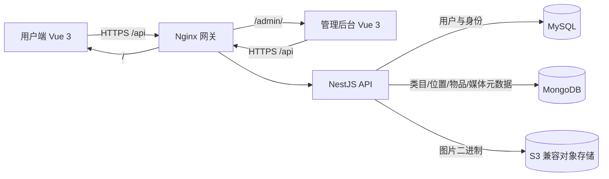
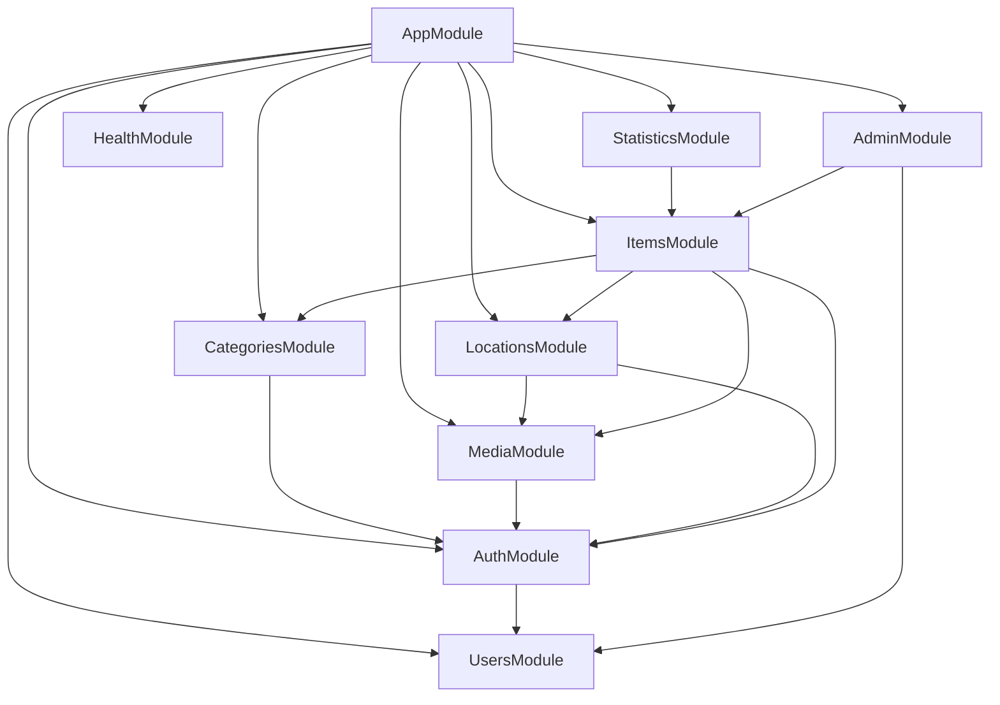
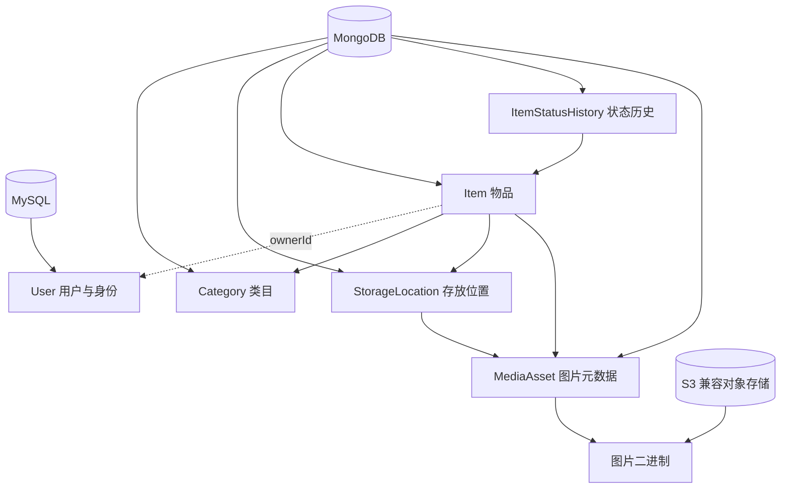
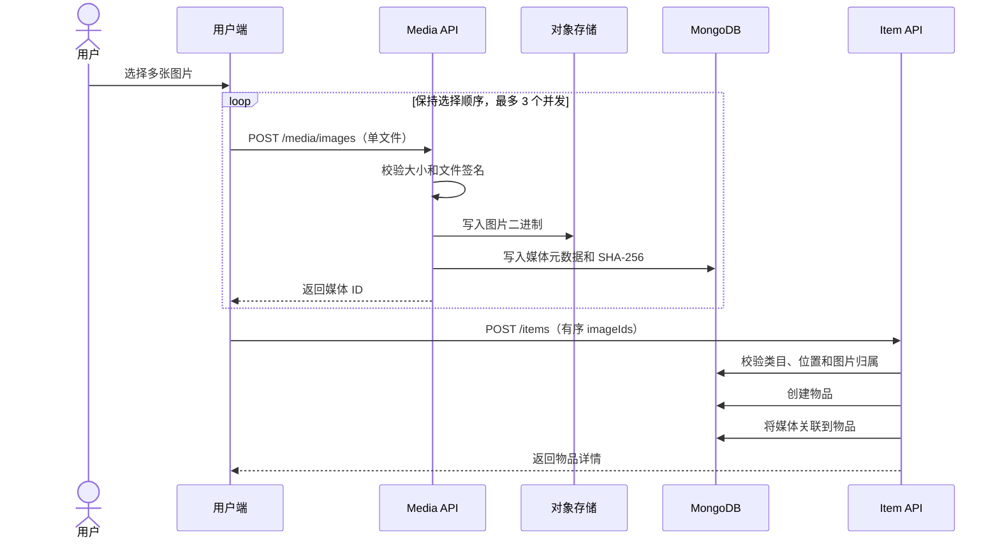
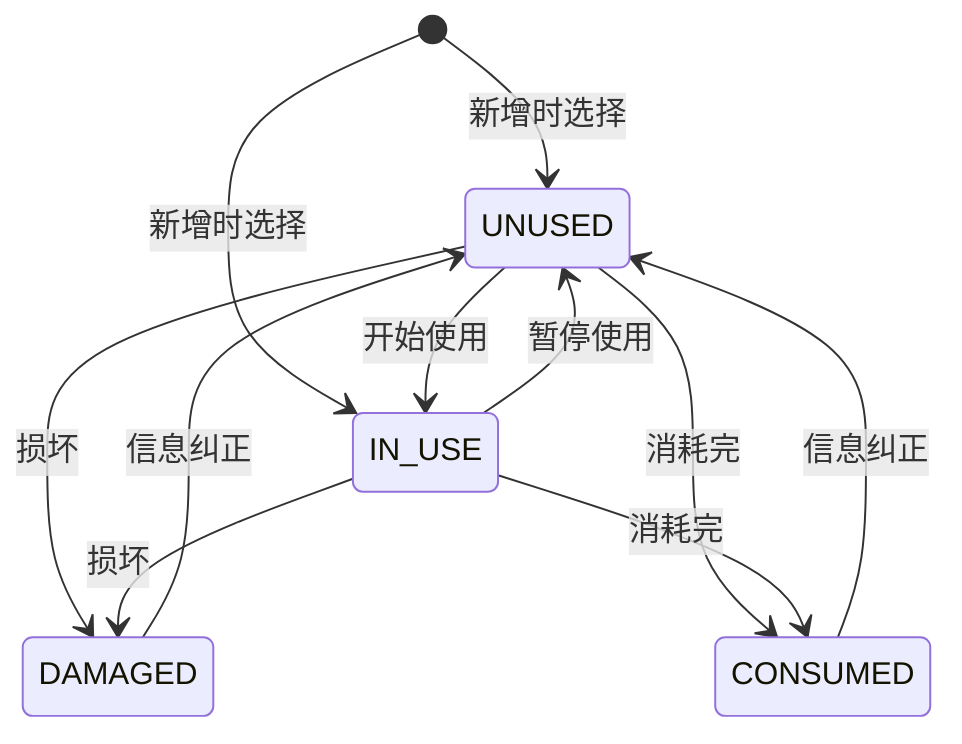
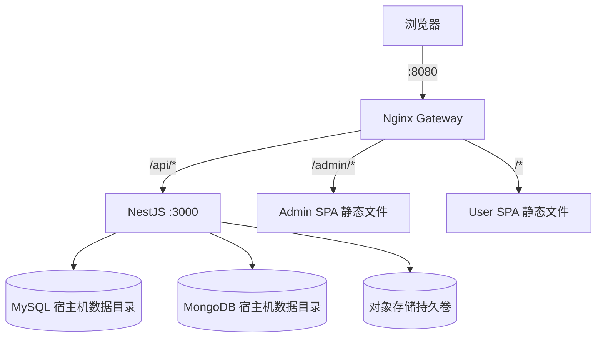

# 物序后端架构设计

> 文档状态：已实现架构基线  
> 适用范围：`apps/api`、MySQL、MongoDB、S3 兼容对象存储及其部署设施  
> 最后更新：2026-10-13

## 1. 文档目的

本文描述物序个人物品管理系统后端的当前架构、模块边界、数据模型、接口权限、关键业务流程和部署方式，并列出下一阶段需要治理的技术风险。

文档以仓库当前代码为事实来源。标记为“后续建议”的内容尚未实现，不应作为现有能力对外承诺。

## 2. 系统定位与边界

物序后端是一个 NestJS 模块化单体应用，对用户端和管理后台提供统一 REST API。

当前职责包括：

- 用户登录、JWT 签发及用户/管理员角色鉴权。
- 管理员维护全局两级类目和全局存放位置，普通用户维护仅本人可见的个人位置。
- 用户登记、查询、编辑、删除自己的物品。
- 记录物品状态及状态变更历史。
- 跟踪使用中消耗品的预计使用周期、时间进度和待检查状态。
- 保存食品等物品的到期日，并提供到期统计。
- 接收图片、校验文件内容，将二进制保存到对象存储。
- 为用户提供个人统计，为管理员提供全局统计和跨用户只读查询。
- 提供存活与就绪健康检查以及 OpenAPI 文档。

当前不包含：

- 用户自助注册、找回密码、多因素认证和第三方登录。
- 移动端离线同步、消息通知和到期提醒任务。
- 库存出入库流水、采购、借用、共享和多人家庭空间。
- 后端直接接收多文件；多图由前端按顺序、限并发调用单文件上传接口。
- 独立微服务、消息队列、搜索引擎和数据仓库。

## 3. 架构目标

| 目标 | 当前实现策略 |
| --- | --- |
| 清晰的业务边界 | 按认证、用户、类目、位置、物品、媒体、统计、管理端拆分 NestJS 模块 |
| 数据按特性存储 | 身份数据使用 MySQL，物品领域数据使用 MongoDB，图片二进制使用 S3 兼容对象存储 |
| 防止越权 | JWT 守卫、角色守卫、资源所有权检查三层控制 |
| 保持历史可读 | 物品保存类目名称和位置名称快照，主数据改名不影响历史展示 |
| 支持容器化交付 | 固定运行时版本、Docker 多阶段构建、Compose 编排和 Nginx 统一入口 |
| 便于前后端协作 | REST API、Swagger 和 `packages/shared-types` 编译期共享类型 |
| 控制首版复杂度 | 采用模块化单体，不在业务规模尚小时引入分布式系统 |

## 4. 总体架构



后端保持一个部署单元，但内部模块按领域隔离。该设计能够在个人项目阶段减少部署和运维成本，同时保留未来按访问量或职责拆分服务的可能性。

## 5. 关键架构决策

### 5.1 模块化单体，而非微服务

当前业务量、开发人数和运维能力不需要微服务。认证、物品和主数据在一个 NestJS 进程中运行，模块之间通过 Service 依赖协作。这样可以保持调用简单，并避免服务发现、分布式追踪和跨服务事务等额外成本。

拆分服务的触发条件应来自实际压力，例如图片处理任务占用大量资源、统计聚合影响在线请求，或多个团队需要独立发布，而不是预先拆分。

### 5.2 多存储模型

- MySQL 保存用户和身份数据，适合唯一约束、稳定结构和账号状态管理。
- MongoDB 保存类目、位置、物品、状态历史和媒体元数据，适合物品字段后续扩展和聚合查询。
- S3 兼容对象存储保存图片二进制，避免数据库膨胀并保持存储实现可替换。

应用层负责跨存储编排。目前没有跨 MySQL、MongoDB、对象存储的分布式事务。

### 5.3 受控主数据

类目由管理员创建；位置由管理员创建全局数据，或由用户创建个人数据。物品表单始终只选择已有数据：

- 类目固定为“大类 → 小类”两级结构。
- 位置必须包含一张照片，个人位置只对创建者和管理员可见。
- 用户可选位置范围固定为“全局位置 + 本人的个人位置”，不接受任意名称文本。
- 位置存在有效物品引用时不允许删除。
- 物品保存主数据 ID 和名称快照，兼顾关联查询与历史展示。

### 5.4 图片文件与元数据分离

对象存储保存原始文件；MongoDB 保存文件归属、对象键、MIME、大小、SHA-256 校验和及业务关联。业务数据只引用媒体 ID，不直接保存外部 URL，也不将校验和混入物品字段。

### 5.5 软删除与审计

主要 MongoDB 文档使用 `deletedAt` 软删除。物品状态变化另存为不可变历史记录。这样能保留恢复和审计的基础数据，但当前尚未提供恢复接口或状态历史查询接口。

## 6. 技术栈与版本基线

| 层级 | 技术 | 当前版本/约束 |
| --- | --- | --- |
| 运行时 | Node.js | 22.20.0 |
| 包管理器 | pnpm | 10.18.3 |
| 后端框架 | NestJS | 11.1.6 |
| 语言 | TypeScript | 5.9.3 |
| 关系数据库访问 | TypeORM + mysql2 | 0.3.27 / 3.15.3 |
| 文档数据库访问 | Mongoose | 8.19.1 |
| 对象存储客户端 | AWS SDK for JavaScript S3 | 3.1150.0 |
| 认证 | Passport JWT + bcryptjs | JWT 访问令牌 |
| 参数校验 | class-validator / class-transformer | 全局白名单与类型转换 |
| API 文档 | Swagger/OpenAPI | `/api/docs` |
| 数据库 | MySQL / MongoDB | 8.4.6 / 8.0.14 |
| 开发对象存储 | SeaweedFS | 3.94，使用 S3 兼容接口 |
| 网关 | Nginx | 统一提供 `/`、`/admin/`、`/api/` |

版本以根目录 Dockerfile、Compose 和各应用 `package.json` 为准。

## 7. 代码与模块架构

```text
apps/api/src/
├── modules/
│   ├── auth/          # 登录、JWT、认证守卫、角色守卫
│   ├── users/         # MySQL 用户实体、查询、开发账号初始化
│   ├── categories/    # 全局两级类目及选择校验
│   ├── locations/     # 全局/个人位置、照片权限和位置内物品计数
│   ├── items/         # 物品、状态历史、个人/全局查询
│   ├── media/         # 图片上传、访问、删除及业务关联
│   ├── statistics/    # 用户和管理员统计接口
│   ├── admin/         # 管理端跨用户只读查询
│   └── health/        # 存活和依赖就绪检查
├── app.module.ts  # 基础设施与业务模块装配
└── main.ts        # HTTP、CORS、校验、Swagger、优雅关闭
```

模块依赖关系：



### 7.1 模块职责

| 模块 | 数据源 | 对外职责 |
| --- | --- | --- |
| `UsersModule` | MySQL | 按 ID/邮箱查询用户，初始化开发账号 |
| `AuthModule` | MySQL | 校验账号状态与密码，签发 JWT，提供认证和角色守卫 |
| `CategoriesModule` | MongoDB | 类目树查询、管理员维护、物品选项合法性校验 |
| `LocationsModule` | MongoDB + 媒体服务 | 位置维护、位置照片关联、位置内物品计数 |
| `ItemsModule` | MongoDB + 主数据/媒体服务 | 物品 CRUD、状态变更、查询和聚合基础能力 |
| `MediaModule` | MongoDB + S3 | 文件校验、存取、元数据和业务关联同步 |
| `StatisticsModule` | MongoDB | 封装个人和全局统计接口 |
| `AdminModule` | MongoDB + MySQL | 管理员跨用户物品查询并补充用户信息 |
| `HealthModule` | 全部基础设施 | 存活检查和依赖就绪检查 |

### 7.2 请求处理管线

```mermaid
flowchart LR
    REQ[HTTP 请求] --> CORS[CORS]
    CORS --> PREFIX[/api 路由前缀]
    PREFIX --> VALIDATE[ValidationPipe]
    VALIDATE --> JWT[JwtAuthGuard]
    JWT --> ROLE[RolesGuard 可选]
    ROLE --> CTRL[Controller]
    CTRL --> SERVICE[Domain Service]
    SERVICE --> STORE[(数据存储)]
```

全局参数校验启用以下规则：

- `whitelist: true`：仅保留 DTO 声明字段。
- `forbidNonWhitelisted: true`：包含未知字段时直接拒绝请求。
- `transform: true`：将输入转换为 DTO 类型。
- 启用隐式基础类型转换，便于处理分页和筛选查询参数。

## 8. 身份、认证与授权

### 8.1 用户模型

MySQL `users` 表保存：

- UUID 主键。
- 唯一邮箱。
- bcrypt 密码哈希。
- 显示名称。
- `USER` 或 `ADMIN` 角色。
- `ACTIVE` 或 `DISABLED` 状态。
- 创建和更新时间。

系统当前通过受控种子数据创建初始账号，不提供公开注册接口。种子程序只补充不存在的用户，不覆盖已有账号密码。

### 8.2 登录流程

1. 客户端以邮箱和密码调用登录接口。
2. 后端按邮箱读取 MySQL 用户。
3. 检查用户状态必须为 `ACTIVE`，再使用 bcrypt 校验密码。
4. 签发包含用户 ID、邮箱、显示名和角色的 JWT。
5. 后续请求通过 `Authorization: Bearer <token>` 提交。
6. JWT 守卫验签并将身份写入当前请求，角色守卫再检查管理员权限。

当前只有访问令牌，没有刷新令牌和服务端会话。默认过期时间为 2 小时，可通过环境变量调整。

### 8.3 权限矩阵

| 资源/操作 | 普通用户 | 管理员 |
| --- | --- | --- |
| 登录 | 允许 | 允许 |
| 读取类目树 | 允许 | 允许 |
| 创建、修改、删除类目 | 禁止 | 允许 |
| 读取位置列表和位置照片 | 全局位置 + 本人个人位置 | 全部位置 |
| 创建位置 | 仅个人位置 | 仅全局位置 |
| 修改位置 | 暂未开放 | 允许 |
| 删除位置 | 仅本人个人空位置 | 允许删除空位置 |
| 新增、查询、修改、删除物品 | 仅本人数据 | 当前通过用户接口仅本人数据 |
| 改变物品状态 | 仅本人数据 | 当前通过用户接口仅本人数据 |
| 跨用户查询物品 | 禁止 | 只读允许 |
| 查看统计 | 个人统计 | 个人统计和全局统计 |
| 删除图片 | 仅本人且未关联图片 | 同样受资源规则约束 |

授权由后端执行，前端隐藏按钮仅用于改善体验，不构成安全边界。

## 9. 数据架构

### 9.1 数据归属



虚线表示跨数据库逻辑引用，不由数据库外键约束。所有跨存储关系都由应用服务校验。

### 9.2 MongoDB 集合

#### `categories`

| 字段 | 说明 |
| --- | --- |
| `managedByAdmin` | 标识全局受控数据 |
| `level` | `BIG` 或 `SMALL` |
| `parentId` | 小类对应的大类 ID，大类为空 |
| `name` / `normalizedName` | 展示名称和归一化名称 |
| `sortOrder` | 展示排序 |
| `deletedAt` | 软删除时间 |

同一父级下通过应用层阻止归一化后的重名。大类存在有效小类时不能删除。

#### `storage_locations`

| 字段 | 说明 |
| --- | --- |
| `name` / `normalizedName` | 位置名称及归一化值 |
| `description` | 位置说明 |
| `photoImageId` | 必填的位置照片媒体 ID |
| `createdBy` | 操作者用户 ID |
| `scope` | `GLOBAL` 全局位置或 `PERSONAL` 个人位置；历史数据默认全局 |
| `ownerId` | 个人位置所属用户 ID，全局位置为空 |
| `deletedAt` | 软删除时间 |

位置修改时同步更新现有物品的位置名称快照。个人位置只允许所属用户在用户接口中读取、选用和删除；管理员接口可读取全部位置。位置存在有效物品时拒绝删除。

#### `items`

| 字段 | 说明 |
| --- | --- |
| `ownerId` | MySQL 用户 UUID 的逻辑引用 |
| `name` | 物品名称，最长 120 字符 |
| `bigCategoryId/Name` | 大类 ID 和名称快照 |
| `smallCategoryId/Name` | 可选小类 ID 和名称快照 |
| `quantity` / `unit` | 数量与单位；数量最多三位小数 |
| `locationId/Name` | 位置 ID 和名称快照 |
| `expiresOn` | 可选到期日 |
| `status` | `IN_USE`、`UNUSED`、`DAMAGED`、`CONSUMED` |
| `isConsumable` | 是否为消耗品；历史数据缺失时按 `false` 返回 |
| `expectedConsumptionDays` | 使用中消耗品本轮预计使用天数，范围 1～36500 |
| `consumptionStartedAt` | 本轮进入使用中状态的开始时间 |
| `imageIds` | 有顺序的图片媒体 ID 数组 |
| `remark` | 可选备注，最长 1000 字符 |
| `deletedAt` | 软删除时间 |
| `version` | Mongoose 乐观并发版本 |

主要索引围绕 `ownerId + createdAt`、`ownerId + status + createdAt` 以及消耗品状态/开始时间建立，支持个人列表、状态筛选、待检查筛选和时间排序。

#### `item_status_history`

每次真实状态变化记录物品、所有者、原状态、新状态、可选原因、操作者和发生时间。历史记录与当前状态分开保存，便于后续审计和时间线展示。

#### `media_assets`

| 字段 | 说明 |
| --- | --- |
| `ownerId` | 上传者 ID |
| `objectKey` | 对象存储唯一键 |
| `originalName` | 原始文件名 |
| `mimeType` / `size` | 服务端识别的 MIME 和大小 |
| `checksumSha256` | 文件 SHA-256 校验和 |
| `linkedItemId` | 可选物品关联 |
| `linkedLocationId` | 可选位置关联 |
| `linkedLocationOwnerId` | 个人位置所属用户；全局位置为空，用于照片读取鉴权 |
| `deletedAt` | 软删除时间 |

物品图片和位置照片共用媒体模型，但关联字段互斥。图片校验和只属于媒体元数据，不写入物品业务数据。

### 9.3 快照策略

物品同时保存类目/位置 ID 和名称快照：

- ID 用于筛选、关系校验和管理。
- 名称快照让历史物品在类目删除后仍可解释。
- 位置重命名会主动同步物品快照，保证用户看到当前物理位置名称。
- 类目重命名不修改已有物品快照，保留登记时语义。

两种主数据采用不同同步策略是当前业务规则，应在后续修改时保持明确。

## 10. API 设计

所有业务接口统一使用 `/api` 前缀，Swagger 文档位于 `/api/docs`。

### 10.1 主要路由

| 方法 | 路由 | 权限 | 作用 |
| --- | --- | --- | --- |
| `POST` | `/auth/login` | 公开 | 登录并获取 JWT |
| `GET` | `/auth/me` | 已登录 | 获取当前 JWT 对应的用户信息 |
| `GET` | `/categories/tree` | 已登录 | 获取全局两级类目树 |
| `POST/PATCH/DELETE` | `/categories...` | 管理员 | 维护类目 |
| `GET` | `/locations?keyword=` | 已登录 | 搜索全局位置和本人个人位置，并返回当前用户物品数量 |
| `POST` | `/locations` | 已登录 | 创建带必填照片的个人位置 |
| `DELETE` | `/locations/:id` | 本人个人位置 | 删除未被物品引用的个人位置 |
| `GET/POST/PATCH/DELETE` | `/admin/locations...` | 管理员 | 创建全局位置、查看及管理全部位置与全局物品数量 |
| `GET/POST/PATCH/DELETE` | `/items...` | 已登录、本人资源 | 物品查询和 CRUD |
| `PATCH` | `/items/:id/status` | 已登录、本人资源 | 改变物品状态并写历史 |
| `POST` | `/media/images` | 已登录 | 上传单张图片 |
| `GET` | `/media/images/:id/content` | 已登录、满足资源访问规则 | 获取图片内容 |
| `DELETE` | `/media/images/:id` | 上传者且未关联 | 删除图片 |
| `GET` | `/statistics/overview` | 已登录 | 获取个人统计 |
| `GET` | `/admin/items...` | 管理员 | 跨用户只读查询与详情 |
| `GET` | `/admin/statistics/overview` | 管理员 | 获取全局统计 |
| `GET` | `/health/live` | 公开 | 进程存活检查 |
| `GET` | `/health/ready` | 公开 | MySQL、MongoDB、对象存储就绪检查 |

具体字段和实时接口定义以 Swagger 为准。

### 10.2 列表查询约定

物品列表支持：

- 关键词搜索。
- 状态、大类和存放位置筛选。
- 消耗品、非消耗品和达到预计周期的待检查消耗品筛选。
- 用户端自动限定当前 `ownerId`。
- 管理端可额外按用户筛选。
- 页码分页，每页最大 100 条。
- 默认按创建时间倒序。

关键词进入正则查询前会被转义，避免用户输入改变正则语义。

## 11. 核心业务流程

### 11.1 新增物品与图片



对象存储写入成功、媒体元数据写入失败时，后端会尝试删除刚写入的对象作为补偿。物品创建与媒体关联目前不是 MongoDB 事务，异常时仍可能出现需要清理的不一致数据。

### 11.2 创建存放位置

1. 管理员或普通用户先上传位置照片，得到媒体 ID。
2. 管理员调用后台接口创建全局位置；普通用户调用用户接口创建个人位置，并提交名称、说明和照片 ID。
3. 后端校验照片归属和未关联状态。
4. 创建位置并将范围、个人位置所属用户和媒体关联写入 MongoDB。
5. 查询和物品选项只返回全局位置与当前用户的个人位置，不允许提交任意位置文本或其他用户的位置 ID。

### 11.3 物品状态变化



当前后端没有限制状态迁移图，所有枚举状态之间都可由资源所有者修改；上图表达常见业务路径，不是强制状态机。每次状态实际发生变化时，后端写入一条状态历史。

消耗品进入 `IN_USE` 时必须提供预计使用天数，后端自动记录本轮开始时间；离开 `IN_USE` 时清除本轮进度，再次进入时开始新一轮。达到预计天数不会自动改为 `CONSUMED`，只返回 `dueForCheck` 供用户端和管理后台提示检查。

### 11.4 管理员跨数据库查询

管理员物品列表先从 MongoDB 查询物品，再收集其中的 `ownerId`，批量从 MySQL 读取用户，最后在应用层组装展示结果。这是应用层逻辑关联，不是数据库 JOIN。

## 12. 数据一致性与并发

### 12.1 已有机制

- `Item` 启用 Mongoose `version` 和乐观并发控制，降低并发覆盖风险。
- 类目、位置、物品和媒体均通过 `deletedAt` 过滤有效数据。
- 图片写入失败时不会创建业务记录；元数据写入失败时尝试回滚对象文件。
- 位置删除前检查是否存在有效物品引用。
- 图片关联前检查归属、删除状态和是否已关联。
- 图片 ID 数组去重，同时保持客户端提交顺序。

### 12.2 当前一致性边界

下列操作跨集合或跨存储，但当前没有统一事务：

- 对象文件写入与媒体元数据写入。
- 物品创建与图片关联。
- 位置创建/更新与照片关联。
- 状态历史写入与物品当前状态更新。
- MySQL 用户和 MongoDB 物品的逻辑关联。

因此系统采用“先校验、顺序写入、局部补偿”的最终一致性策略。对于个人使用规模可接受，但必须通过日志、清理任务和可重试操作进一步增强。

### 12.3 后续建议

1. 对仅涉及 MongoDB 的多文档写入使用 session transaction，部署 MongoDB 副本集。
2. 为对象存储与 MongoDB 设计可重试的 Saga/补偿记录，增加孤儿文件定期清理任务。
3. 将状态变更调整为先提交当前状态与历史的同一事务。
4. 为幂等性敏感的新增接口支持 `Idempotency-Key`。
5. 明确定义软删除后的图片保留周期和恢复/彻底清理策略。

## 13. 图片安全与访问规则

上传处理规则：

- 单文件最大 10 MiB。
- 仅接受 JPEG、PNG、GIF、WebP。
- 不信任浏览器声明的扩展名和 MIME，服务端检查文件魔数。
- 以 UUID 生成对象键，不直接使用用户文件名作为存储路径。
- 计算 SHA-256 作为完整性元数据。
- 对象存储桶在服务启动时自动确认或创建。

读取规则：

- 管理员可读取媒体。
- 上传者可读取自己的媒体。
- 已关联全局位置的照片可由任意已登录用户读取。
- 已关联个人位置的照片只允许该位置所属用户和管理员读取；即使知道媒体 ID，其他用户也会得到“图片不存在”。
- 响应使用私有缓存，并设置 `X-Content-Type-Options: nosniff`。

直接删除只允许图片所有者操作，且图片必须尚未关联物品或位置。

当前上传和下载都在应用内存中使用 Buffer，适合 10 MiB 上限和个人规模；若提升文件限制或并发量，应改为流式传输，并考虑缩略图、EXIF 清理和恶意文件扫描。

## 14. 统计架构

统计由 MongoDB 聚合管道实时计算，使用 `$facet` 一次返回多组指标：

- 物品总数和数量合计。
- 各状态数量。
- 类目分布前 12 项。
- 即将到期和已经到期的数据。
- 管理端全局统计中至少拥有一件有效物品的去重用户数。
- 已达到预计使用周期、需要检查的使用中消耗品数量。

已消耗物品不参与到期/过期统计。用户统计固定按当前用户过滤；管理员统计覆盖所有用户有效物品。

当前规模下实时聚合足够。数据量明显增长后，可根据慢查询证据增加复合索引、缓存或异步统计快照，不应在没有性能数据时预先复杂化。

## 15. 健康检查与可观测性

### 15.1 当前能力

- `/health/live`：确认 NestJS 进程能够响应，返回服务状态、版本和时间。
- `/health/ready`：分别执行 MySQL `SELECT 1`、MongoDB `ping` 和对象存储 HTTP 连通性检查。
- 就绪检查为对象存储设置 2 秒超时，任一依赖异常时返回降级状态。
- NestJS 启用 shutdown hooks，便于容器优雅退出。

当前 Docker 容器健康检查使用 `live`，所以它验证进程存活，不验证所有依赖可用。

### 15.2 后续建议

- 生产编排将流量就绪判断切换到 `/health/ready`，同时保留 `live` 用于进程重启判断。
- 引入结构化 JSON 日志，请求 ID 贯穿网关、API 和数据访问。
- 对登录失败、5xx、上传失败、依赖延迟和统计查询延迟建立指标。
- 增加集中式错误追踪和告警，但不得在日志中记录密码、JWT 或图片内容。
- 为跨存储补偿失败建立专用审计日志和运营处理入口。

## 16. 配置设计

应用通过环境变量注入配置，主要分组如下：

| 分组 | 变量 |
| --- | --- |
| HTTP | `PORT`、`CORS_ORIGINS` |
| JWT | `JWT_SECRET`、`JWT_EXPIRES_IN` |
| MySQL | `MYSQL_HOST`、`MYSQL_PORT`、`MYSQL_DATABASE`、`MYSQL_USER`、`MYSQL_PASSWORD`、`MYSQL_SYNCHRONIZE`；Compose 使用 `MYSQL_DATA_PATH` 配置宿主机持久化目录 |
| MongoDB | `MONGODB_URI`；Compose 使用 `MONGODB_DATA_PATH`、`MONGODB_CONFIG_PATH` 配置宿主机持久化目录 |
| S3 | `S3_ENDPOINT`、`S3_REGION`、`S3_BUCKET`、`S3_ACCESS_KEY`、`S3_SECRET_KEY` |
| 开发种子 | `SEED_DEV_USERS` 及开发用户/管理员账号变量 |

生产要求：

- 使用高强度、独立的 JWT 和数据库密钥，不提交到仓库。
- 明确配置允许的 CORS 来源，禁止使用不受控的通配来源。
- 通过部署环境的 Secret 管理能力注入敏感值。
- `SEED_DEV_USERS` 仅在明确需要初始化受控账号时开启。
- 在正式数据库迁移机制建立后关闭 `MYSQL_SYNCHRONIZE`。

## 17. 构建与部署架构

### 17.1 容器构建

根目录 Dockerfile 使用多阶段构建：

1. 安装 Monorepo 依赖。
2. 构建共享类型和三个应用。
3. API 运行镜像只保留后端运行所需产物。
4. 以非 root 的 `node` 用户运行后端，监听容器端口 3000。

生产可以使用 GitHub Actions 发布的 GHCR 镜像，也可以使用 `compose.source-build.yaml` 让 Docker BuildKit 直接从远程 Git 仓库拉取源码并构建。

### 17.2 生产拓扑



只有 Nginx 对外暴露端口。MySQL、MongoDB、对象存储和 API 位于 Compose 内部网络。API 等待三个存储健康后启动，网关等待 API 健康后提供服务。

### 17.3 路由约定

- `/`：用户端。
- `/admin/`：管理后台，`/admin` 重定向到带尾斜杠地址。
- `/api/`：代理到 NestJS。

该约定使前端和 API 在同一来源下工作，生产环境通常无需额外 CORS 通信。

## 18. 性能与扩展策略

当前设计面向个人使用和小规模部署：

- API 可以在无本地状态的前提下水平扩容；JWT 不依赖进程会话。
- 图片保存在共享对象存储，不依赖 API 容器文件系统。
- MongoDB 索引覆盖主要的用户、状态和时间查询。
- 管理员跨库关联在应用层批量读取用户，避免逐条查询。
- 列表每页最多 100 条，防止无界响应。

扩展顺序建议：

1. 先通过慢查询、延迟和错误指标确认瓶颈。
2. 优化 MongoDB 索引和聚合管道。
3. 为只读热点增加短期缓存。
4. 将图片缩略图、清理和提醒任务移入异步工作进程。
5. 只有出现独立伸缩或团队边界时，再拆分媒体或统计服务。

## 19. 已知风险与技术债

| 优先级 | 现状/风险 | 建议处理 |
| --- | --- | --- |
| P0 | 生产配置仍可能依赖 `MYSQL_SYNCHRONIZE`，没有正式迁移文件 | 建立 TypeORM migration，生产关闭自动同步 |
| P0 | 仓库当前没有 API 自动化测试 | 增加服务单测、控制器集成测试和真实依赖 E2E |
| P1 | 多集合、跨存储写入不具备原子性 | MongoDB 事务 + 补偿任务 + 幂等键 |
| P1 | 缺少全局异常格式、结构化日志和请求追踪 | 统一异常过滤器、日志拦截器和 request ID |
| P1 | 登录接口没有限流和连续失败保护 | 增加速率限制、审计和可选账号临时锁定 |
| P1 | 状态历史已保存但没有查询接口 | 增加本人/管理员只读时间线接口 |
| P1 | 软删除媒体缺少定期清理和恢复策略 | 定义保留期，增加孤儿对象扫描与清理任务 |
| P2 | 位置服务直接注册物品 Schema，存在领域耦合 | 提取引用查询端口或领域服务，减少跨模块模型访问 |
| P2 | API 图片传输全量进入内存 | 改为流式上传/下载，增加缩略图与内容扫描 |
| P2 | 只有访问令牌，没有刷新和主动撤销能力 | 视使用场景增加短期访问令牌与刷新令牌轮换 |
| P2 | Docker 健康检查只使用存活接口 | 分离 liveness 与 readiness 的编排用途 |

P0 项应在首次正式公网部署和真实数据长期保存前完成。

## 20. 建议的测试分层

当前代码尚未建立自动化测试基线，建议按以下顺序补齐：

1. 单元测试：状态变更、类目关系校验、位置删除约束、图片权限和查询过滤器。
2. 数据访问集成测试：使用临时 MySQL/MongoDB/S3 容器验证索引、软删除和对象补偿。
3. API E2E：覆盖登录、角色越权、完整物品生命周期、位置照片和管理员查询。
4. 契约测试：校验 Swagger 与前端共享类型中的枚举和响应结构一致。
5. 部署冒烟：启动生产 Compose 后检查 `/health/ready`、用户端、`/admin/` 和核心 API。

最低发布门槛应包含类型检查、构建、API E2E 和 Compose 健康检查。

## 21. 演进路线

### 第一阶段：生产基线

- 数据库迁移和备份恢复演练。
- 自动化测试与统一错误响应。
- 日志、指标、限流和 Secret 管理。
- 明确图片与软删除数据的生命周期。

### 第二阶段：体验增强

- 状态历史时间线查询。
- 到期提醒与后台任务。
- 图片缩略图和流式传输。
- 管理端审计日志与数据导出。

### 第三阶段：按证据扩展

- 根据查询指标增加缓存或搜索能力。
- 将耗时图片任务拆分为异步 Worker。
- 当独立伸缩和发布需求明确后，再评估媒体/统计服务拆分。

## 22. 架构约束总结

后续实现必须遵守以下基线：

1. 用户和身份数据归 MySQL；物品领域数据归 MongoDB；图片二进制归对象存储。
2. 类目是管理员维护的全局主数据；位置分为后台全局位置与用户个人位置，物品端均不能提交自定义文本或越权 ID 替代合法位置。
3. 任何物品读写都必须执行资源所有权校验；管理员跨用户入口保持独立路由和明确权限。
4. 图片文件顺序由 `imageIds` 数组定义；多文件上传保持用户选择顺序并限制浏览器并发。
5. 文件校验和只保存在媒体元数据中，不写入物品业务字段。
6. 数量为 `0` 等合法值时，更新逻辑必须使用显式空值判断，不能依赖 truthy/falsy。
7. 状态历史审阅只读，不得因查看历史而改变当前物品状态或触发业务动作。
8. 新增跨存储写入流程时，必须同时设计失败补偿、幂等性和孤儿数据清理方案。
9. 生产入口继续由 Nginx 统一代理，管理后台固定使用 `/admin/`，API 固定使用 `/api/`。
10. 架构文档、Swagger、共享类型和实际代码应在同一个变更中保持同步。

## 23. 相关文档

- [产品范围](./product-scope.md)
- [开发环境](./development.md)
- [本地部署指南](./local-deployment.md)
- [生产部署指南](./deployment.md)
- [API 目录说明](../apps/api/README.md)

